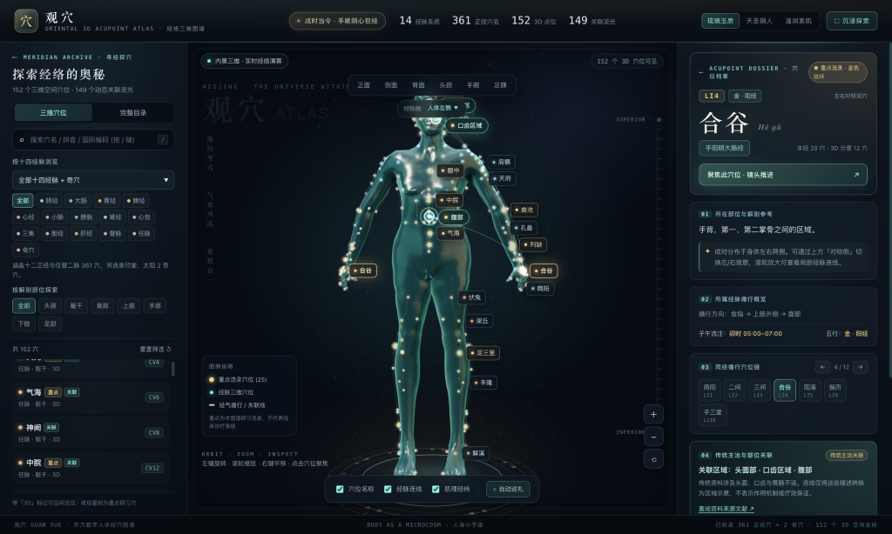

<div align="center">

# 观穴 · 3D 东方人体经络穴位图谱
### GuanXue — Interactive 3D Oriental Human Acupoint & Meridian Atlas

[](https://aicuc.github.io/acupoint/)
[](https://threejs.org/)
[](#核心特性--features)
[](#本地快速运行--quick-start)

**融合传统中医《内景图》《天圣针灸铜人》美学与现代 WebGL 三维数字解剖的可视化开源图谱**  
*An open-source 3D interactive atlas of Traditional Chinese Medicine (TCM) meridians and acupoints, built with pure Vanilla JS & Three.js.*

[**👉 点击进入在线 3D 交互图谱 (Live Demo)**](https://aicuc.github.io/acupoint/) · [**🌟 觉得有用请点右上角 Star 支持！**](https://github.com/aicuc/acupoint)

</div>

---

## 📸 预览截图 · Preview



---

## ✨ 核心特性 · Features

- 🏺 **三种博物级 3D 人体材质一键切换（3 Sculptural Body Shaders）**
  - **琉璃玉质（Celadon Jade）**：东方半透明青玉质感 + 次表面微光 + 可开关的解剖肌理经纬网格，令穴位与经脉流光通透浮现。
  - **天圣铜人（Imperial Bronze）**：致敬北宋《天圣针灸铜人》，古铜金属光泽配青铜绿包浆高光。
  - **温润素肌（Sculptural Alabaster）**：现代医学雕塑素肌质感，适合清晰观察体表解剖标志。
- 🧭 **太极子午流注罗盘底座（Ziwu Liuzhu Celestial Compass）**
  - 脚下实时旋转的十二地支 × 十二正经罗盘底座，顶部导航栏根据当前系统时间**自动高亮当令时辰与值班经脉**（如 `戌时当令 · 手厥阴心包经`），支持一键筛选当令经脉。
- 🌟 **曲面贴合经脉与动态关联流光（Surface-Hugging Meridians & Qi Flow）**
  - **152 个三维空间穴位点** + **十四经脉 361 穴完整标准目录索引**（含国际标准编码、汉语拼音、五行属性、阴阳表里与循行路线）。
  - **25 个核心重点研习穴位**（金色双环呼吸靶标），选中穴位时自动生成贴合体表法线的三维双环动态波纹。
  - **149 组传统主治区域三维流光弧线**：支持合谷、内关、足三里、风池、中脘、委中、列缺、太冲等穴位到对应症状区域的双层体积光管与粒子流动演示。
- 🎥 **丝滑镜头运镜与人体工学交互（Cinematic Camera & Keyboard Shortcuts）**
  - 预设 **正面 / 侧面 / 背面 / 头颈 / 手腕 / 足踝** 六大解剖特写机位，点击任意穴位或同经循行链（支持键盘 `←` / `→` 方向键）即可平滑推进镜头。
  - 支持按 `/` 键快速唤醒拼音/穴名/国际编码（如 `LI4`、`ST36`、`hegu`）即时检索，支持 `⛶ 沉浸探索` 全屏模式。
- ⚡ **零构建、零外部依赖（Zero Build, Self-Contained）**
  - 纯原生 HTML + CSS + ES Modules，内置 Three.js r170 与 CC0 授权三维人体网格数据，**无需 `npm install` 或打包工具**，Fork 后开启 GitHub Pages 即可秒级部署属于你自己的 3D 经穴网站。

---

## 🚀 本地快速运行 · Quick Start

本项目无需安装 Node.js 或任何编译工具，只需本地任意静态 HTTP 服务即可运行：

```bash
# 1. 克隆仓库
git clone https://github.com/aicuc/acupoint.git
cd acupoint

# 2. 启动本地 HTTP 服务（Python 3）
python3 -m http.server 8000 --bind 127.0.0.1 --directory docs
```

浏览器打开 **[http://127.0.0.1:8000](http://127.0.0.1:8000)** 即可体验（Windows 用户可将 `python3` 替换为 `py`）。

---

## 🗂️ 项目结构 · Project Structure

```text
docs/
├── index.html               # 主页面结构（顶部子午流注栏、左侧检索、中央 3D 舞台、右侧穴位档案）
├── style.css                # 东方黑曜青玉与鎏金视觉样式表（支持桌面/宽屏/移动端与沉浸模式）
├── app.js                   # Three.js 场景、三种人体材质、罗盘底座、曲面经脉线与交互控制
├── points.js                # 152 个三维空间穴位坐标与解剖部位描述
├── catalog.js               # 十四经脉 361 穴完整名称、编码与循行路线索引
├── effects.js               # 149 组穴位—部位传统主治关联数据与三维流光弧线渲染
├── human-model.js           # 压缩编码的三维人体网格与体表最近点投射算法 (CC0)
├── three.module.js          # Three.js r170 核心模块
└── OrbitControls.js         # 三维相机轨道控制器
```

---

## 🌐 一键 Fork 部署属于你的 3D 经穴图谱 · Deploy on GitHub Pages

1. 点击本仓库右上角的 **🌟 Star** 与 **🍴 Fork** 按钮。
2. 进入你 Fork 后的仓库 **Settings → Pages**。
3. 在 **Build and deployment** 中：
   - **Source** 选择 `Deploy from a branch`
   - **Branch** 选择 `main`，目录选择 `/docs`，点击 **Save**。
4. 等待约 30 秒，即可通过 `https://<你的用户名>.github.io/<仓库名>/` 访问！

---

## ⚠️ 免责声明 · Disclaimer

本项目中的三维人体模型、穴位空间坐标、体表同经连线以及部位关联流光均为**传统文化科普与数字化可视化学习示意**，不代表真实解剖神经/血管通路或确定临床疗效，**不可用于临床针刺定位、医疗诊断或疾病治疗**。具体医学与针灸诊疗请务必咨询专业执业中医师。

- 三维人体基础网格改编自 MakeHuman `hm08` (CC0 许可，详见 [docs/HUMAN-MODEL-LICENSE.txt](docs/HUMAN-MODEL-LICENSE.txt))。
- Three.js 遵循 MIT 许可（详见 [docs/THREE-LICENSE.txt](docs/THREE-LICENSE.txt)）。

---

<div align="center">

**如果这个项目对你有启发，欢迎点亮右上角的 ⭐ Star 或分享给对中医经络与 3D 可视化感兴趣的朋友！**

</div>
